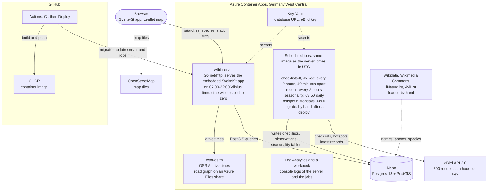

# Where to Bird Today?

Tell it *when* you want to bird, *where* you are, *how far* you will travel, and a few preferences, and
get back a ranked list of places with a summary of what you can realistically expect to see.

**Primary goal: learning Go.** The app is the vehicle.

## Architecture



<details>
<summary>Mermaid source</summary>



</details>

`diagrams/architecture.mmd` is the source of the image. Render it again after a change with
`npx @mermaid-js/mermaid-cli -i diagrams/architecture.mmd -o diagrams/architecture.svg -b white`.

- **One image, two roles.** The Dockerfile builds the web app, then every binary under `cmd/`. The server
  and the scheduled jobs run the same image with a different command.
- **The server answers searches from precomputed tables.** It never calls eBird while answering a request.
  A search is a PostGIS query over hotspots and the weekly frequency of each species at each hotspot,
  with an optional drive-time limit from OSRM.
- **The jobs keep the data current.** They call the eBird API on a schedule and write to Neon.
  See "Data pipeline".
- **Secrets live in Key Vault.** The server and the jobs read them as Container Apps secrets.
- **Deploys go through GitHub Actions.** CI tests a push to `main`. Deploy then builds the image, pushes
  it to GHCR, runs the migrations, and updates the server and the jobs. It signs in to Azure with OpenID
  Connect, so no Azure password is stored in GitHub.

## Stack

| Layer | Choice |
|---|---|
| Backend | Go 1.27, standard-library `net/http` (enhanced `ServeMux`), `log/slog` with JSON output |
| DB access | sqlc (SQL to typed Go) + pgx; goose for migrations |
| Database | PostgreSQL 18 with PostGIS: Neon (free plan) in production, `postgis/postgis:18-3.6` locally |
| Frontend | SvelteKit with `adapter-static` (no server rendering), embedded into the Go binary with `embed`; Leaflet map on OpenStreetMap tiles |
| Routing | OSRM for drive times, on road data for Lithuania, Latvia and Estonia |
| Data | eBird API 2.0, eBird Basic Dataset, AviList v2025b, Wikidata and Wikimedia Commons, iNaturalist |
| Languages | Lithuanian (default) and English |
| Hosting | Azure Container Apps in Germany West Central, defined in Bicep; images in GHCR; secrets in Key Vault; logs in Log Analytics |
| CI/CD | GitHub Actions |

Not used on purpose: Gin, Echo, Fiber and ORMs. The point is to learn the real `net/http` model and to
understand the SQL.

## Choices made

**Data**

- **Region.** The Baltics: Estonia, Latvia and Lithuania. The loaders take the region as configuration
  (`EBIRD_REGIONS`); no loader, schema or query has a country built in.
- **Frequency comes from checklists.** The frequency of a species at a hotspot in a week is the share of
  the hotspot's complete checklists that recorded it. A year has 52 weeks; ISO week 53 is counted in week 52.
- **Hotspots are ranked by an adjusted frequency.** It pulls a hotspot's frequency toward the country's
  frequency for the same species and week, more strongly the fewer checklists it rests on, so one sighting
  in three checklists does not outrank 25% over 200.
- **Species reference data is AviList v2025b.** One CC BY 4.0 spreadsheet gives, for each species, the eBird
  species code, AvibaseID, IUCN Red List status and the Birds of the World and BirdLife DataZone links.
  It is loaded offline into `species`. No request resolves a species identifier over the network.
- **Photos come from Wikidata and Wikimedia Commons first, iNaturalist for the gaps.** The app stores image
  references, never the image files, and licence and attribution are required columns. Macaulay Library is
  only a link target: eBird's API has no media endpoints and Macaulay grants no download rights.

**Behaviour**

- **The app only reads.** It never submits anything to eBird. Each checklist and location identifier from
  eBird is kept, so everything links back to the source for verification.
- **Fresh data comes from scheduled jobs, never from a request.** The jobs respect eBird's limit of 500
  requests an hour for one key, and leave room for each other.
- **The species detail is our own panel, not an iframe.** eBird sends `X-Frame-Options: DENY` and Avibase
  `SAMEORIGIN`, so embedding is not possible, and linking out is the better design anyway. The panel leads
  with the week-of-year seasonality, which is the part no one else has.
- **Lithuanian is the default language.** The Go API never returns a user-facing sentence: it returns
  codes, numbers and names, and the Svelte app writes the prose. Common names live in `species_names`,
  ranked by source, so the fallback from Lithuanian to English to the scientific name is resolved in SQL.
  The language is a request parameter, never global state.

**Operations**

- **The cheapest tier that works.** Neon's free plan holds the database, the server scales to zero outside
  07:00-22:00 Vilnius time, and a budget alert of $25 a month guards the Azure bill.
- **Abuse guardrails.** Per-address rate limits on every search route, a smaller one for drive-time searches,
  bot blocking on the search routes, a cap on parallel OSRM requests, and no route that writes.
- **One image, one deploy path.** The server and every job run the image that CI tested, tagged with the
  commit.

## Data pipeline

The tables the server reads are derived from checklists and observations:

```
eBird API  ->  checklists, observations  ->  compute-seasonality  ->  species_seasonality
                                                                      country_seasonality
                                                                      species_time_of_day, time_of_day_totals
                                                                      hotspot_species_last_seen
```

| Job (UTC) | What it does |
|---|---|
| `checklists-lt`, `-lv`, `-ee`: every 2 hours, 40 minutes apart | Fetch each country's new checklists at known hotspots from the eBird API, from three days before the newest one stored for that country. |
| `recent`: every 2 hours | Move `hotspot_species_last_seen` forward from eBird's recent observations. |
| `seasonality`: 03:50 daily | Rebuild the derived tables from `checklists` and `observations`. |
| `hotspots`: Mondays 03:00 | Refresh the hotspot list. |
| `migrate`: by hand | Run the database migrations after a deploy that adds one. |

- **Rate limit first.** A checklist run reads the remaining hourly quota from eBird's `RateLimit` header and
  stops with 50 requests left for the other jobs, or when eBird answers 429. The next run carries on, so a
  long gap is made up over a few runs.
- **API and export records are the same rows.** The API records use the identifiers of the eBird Basic
  Dataset, so loading an export later updates them instead of duplicating them.
- **Loaders are idempotent.** Rows are upserted, so overlapping runs and date ranges are harmless.

## Layout

```
cmd/             one main package for each binary
  server/          the web server: wiring and startup only
  migrate/         runs the goose migrations
  ingest-*/        the loaders: AviList, EBD, eBird names, hotspots, checklists, recent observations, species media
  compute-seasonality/  rebuilds the derived tables
internal/        app code; the compiler forbids imports from outside this module
  api/             handlers, middleware, routing
  birding/         search, ranking and species detail
  config/          environment-variable loading
  daylight/        sunrise times, for the time-of-day data
  ingest/          one package for each data source
  routing/         the OSRM client and its caches
  store/           connection pool and the sqlc-generated queries
migrations/      goose SQL migrations
deploy/          Bicep template, docker-compose for local use, deploy notes
diagrams/        the architecture diagram
scripts/         local helper scripts
web/             SvelteKit app
```

To run it locally, see [DEVELOPMENT.md](DEVELOPMENT.md).

## Attribution

Third-party data carries licence obligations that the UI must honour, not just the source:

- **AviList** CC BY 4.0. *AviList Core Team. 2026. AviList: The Global Avian Checklist, v2025b.*
  <https://doi.org/10.2173/avilist.v2025b>
- **Wikimedia Commons**: per-image licence and author, shown next to the image.
- **iNaturalist**: per-photo `attribution` string, shown next to the image. Photos default to CC BY-**NC**.
- **eBird / Cornell Lab**: taxonomy and observation data, per the eBird API terms.
- **OpenStreetMap**: map tiles and road data, © OpenStreetMap contributors (ODbL).

## Conventions

- **Line endings are LF**, enforced by `.gitattributes` rather than left to each machine's git config, because
  shell scripts are copied into a Linux container, where CRLF breaks the shebang.
- **`internal/`** is enforced by the Go compiler: no other module can import anything beneath it.
- **Dependencies are wired by hand in `main`**: no container, no service registration.
- **Style follows the [Google Go Style Guide](https://google.github.io/styleguide/go/guide)**, which governs
  over personal preference. The rule with the most visible effect here: **no assertion libraries.** Tests use
  standard comparisons and [`go-cmp`](https://github.com/google/go-cmp), and a failure message names what was
  called: `Load().Port = 9000, want 8080`, never `port = 9000`.
